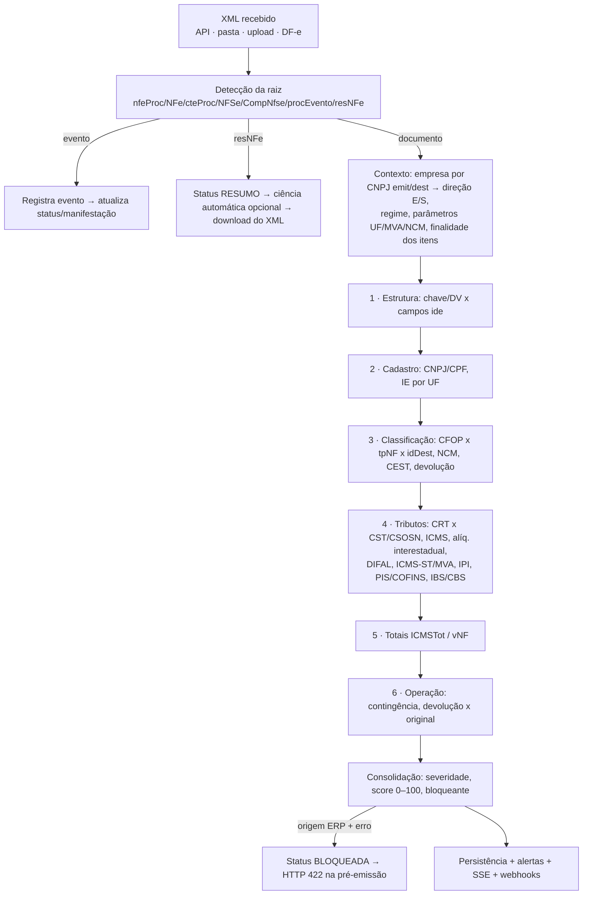
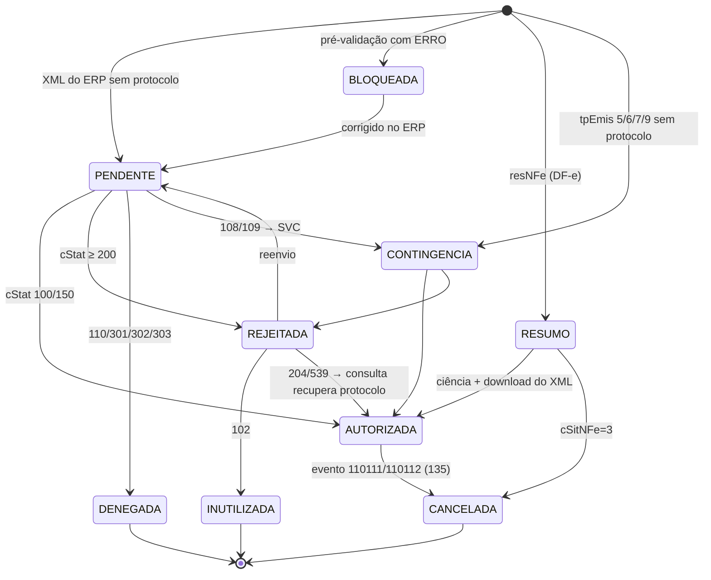

# Vorticis Monitor — Arquitetura e Especificação

Monitor fiscal em tempo real para NF-e (55), NFC-e (65), CT-e (57/67), MDF-e (58), NFS-e (ABRASF e Padrão Nacional) e pré-escrituração SPED (EFD ICMS/IPI e EFD-Contribuições).

> **Escopo legal.** As regras implementadas seguem o MOC NF-e 7.0 e NTs vigentes, a LC 87/96, a EC 87/2015, a LC 190/2022, o Conv. ICMS 142/2018 (ST/CEST), a LC 116/2003 (ISS), as Leis 10.833/03 e 9.430/96 (retenções) e a LC 214/2025 (IBS/CBS, alíquotas-teste de 2026). Tabelas de alíquotas, MVA e URLs de webservices são **parâmetros editáveis** e precisam ser revisados pelo responsável fiscal.

---

## 0. Visão geral

```
                ┌──────────────── Vorticis Monitor (executável único, Go) ─────────────────┐
 ERP ──XML────► │  API REST /api/v1  ─┬─► Ingestão ─► Parser ─► Motor de Regras ─► Store │
 ERP ──pasta──► │  Pasta monitorada  ─┘      ▲                     │              (SQLite│
                │                            │                     ▼               /PG)  │
 SEFAZ/AN ◄────►│  Cliente SOAP mTLS ◄── Captura DF-e / Consulta / Manifestação      │   │
 (cert. A1)     │                                                                    │   │
                │  Agendador: alertas de prazo, contingência, certificado, MDF-e ◄───┘   │
 Navegador ◄───►│  Painel web (SPA embutida) ◄── SSE (tempo real)                         │
 Escrituração ◄─│  Feed /escrituracao, SPED TXT, webhooks HMAC, ZIP XML/DANFE             │
                └─────────────────────────────────────────────────────────────────────────┘
```

| Pacote | Responsabilidade |
|---|---|
| `internal/fiscal` | Validadores (CNPJ numérico **e alfanumérico**, CPF, IE, chave de acesso), tabelas (UF, alíquotas interestaduais, SVC por UF, CFOP, LC 116), catálogo de rejeições |
| `internal/xmlfiscal` | Parse de nfeProc/NFe, cteProc, mdfeProc, NFS-e Nacional, ABRASF, procEvento, resNFe |
| `internal/regras` | Motor de regras + cálculos (DIFAL, MVA ajustada, ICMS-ST, retenções) |
| `internal/sefaz` | Certificado A1 (PFX), webservices por UF, SOAP 1.2 mTLS, Distribuição DF-e, Consulta Protocolo, Status Serviço, Manifestação com XMLDSig |
| `internal/servicos` | Orquestração: ingestão, devolução, conciliação, captura, alertas, agendador, hub SSE/webhooks, máquina de estados |
| `internal/relatorios` | SPED, livros, apurações, retenções, ZIP, DANFE/DACTE/DANFSe (HTML + Code128) |
| `internal/store` | Persistência (esquema relacional) |
| `internal/api` | REST, autenticação (PBKDF2 + token HMAC, API-Key), perfis |
| `web/static` | Painel SPA sem dependências externas |

---

## 1. Estrutura de dados — ERD

```mermaid
erDiagram
  EMPRESA ||--o{ CERTIFICADO : possui
  EMPRESA ||--o{ DOCUMENTO : "emite/recebe"
  EMPRESA ||--o{ NSU_CONTROLE : "captura DF-e"
  EMPRESA ||--o{ PEDIDO_COMPRA : "compra"
  PEDIDO_COMPRA ||--o{ PEDIDO_ITEM : contem
  DOCUMENTO ||--o{ DOCUMENTO_ITEM : contem
  DOCUMENTO ||--o{ DOCUMENTO_EVENTO : "eventos (cancel., CC-e, manifestação)"
  DOCUMENTO ||--o{ DOCUMENTO_REFERENCIA : "NFref / NF-e transportadas"
  DOCUMENTO ||--o{ OCORRENCIA : "achados do motor"
  DOCUMENTO ||--o| CONCILIACAO : "XML x pedido"
  CONCILIACAO }o--|| PEDIDO_COMPRA : referencia
  DOCUMENTO ||--o{ ALERTA : gera
  PARAM_UF ||..o{ OCORRENCIA : "parametriza DIFAL/ST"
  PARAM_MVA ||..o{ OCORRENCIA : "parametriza ST"
  PARAM_NCM ||..o{ OCORRENCIA : "valida NCM"
  USUARIO ||--o{ AUDITORIA : registra

  EMPRESA { int id PK; string cnpj UK; string razao_social; string uf; string ie; string cod_mun; string regime "SN|MEI|LP|LR"; int ambiente "1 prod|2 homolog"; bool captura_automatica; bool ciencia_automatica }
  CERTIFICADO { int id PK; int empresa_id FK; string tipo "A1"; string titular; string cnpj; string serial; date valido_ate; blob pfx_cifrado "AES-256-GCM"; blob senha_cifrada; bool ativo }
  DOCUMENTO { int id PK; int empresa_id FK; string chave UK; string modelo "NFE|NFCE|CTE|MDFE|NFSE"; string direcao "E|S"; string tipo_operacao; string status; int c_stat; string protocolo; string tp_emis; string fin_nfe; decimal valor_total; decimal valor_icms; decimal valor_st; decimal valor_difal; decimal valor_iss; decimal valor_retencoes; string manifestacao; string conciliacao; int score; bool resumo; text xml; string hash }
  DOCUMENTO_ITEM { int id PK; int documento_id FK; int n_item; string ncm; string cest; string cfop; string cst_icms; decimal v_bc; decimal p_icms; decimal v_icms; decimal v_bc_st; decimal p_mva; decimal v_icms_st; string cst_ipi; string cst_pis; string cst_cofins; decimal v_difal; string ped_compra; string item_ped }
  DOCUMENTO_EVENTO { int id PK; string chave; string tp_evento; int n_seq; string protocolo; int c_stat; text xml }
  OCORRENCIA { int id PK; int documento_id FK; string regra; string grupo; string severidade "ERRO|ALERTA|INFO"; int n_item; string campo; string esperado; string informado; int cod_rejeicao; string acao_correcao; bool resolvida }
  ALERTA { int id PK; string tipo; string severidade; string titulo; datetime vence_em; bool lido; string chave_unica UK }
  NSU_CONTROLE { int empresa_id PK; string servico PK; string ult_nsu; string max_nsu; datetime proxima_consulta; int ultimo_c_stat }
  PEDIDO_COMPRA { int id PK; int empresa_id FK; string numero; string fornecedor_cnpj; string status }
  PEDIDO_ITEM { int id PK; int pedido_id FK; string item; string cod_produto_fornecedor; string ncm; decimal quantidade; decimal valor_unitario; decimal quantidade_recebida; string finalidade "REVENDA|INDUSTRIALIZACAO|USO_CONSUMO|ATIVO" }
  CONCILIACAO { int id PK; int documento_id FK; int pedido_id FK; string ordem_recebimento; string status; json divergencias }
  PARAM_UF { string uf PK; decimal aliq_interna; decimal fcp; string difal_metodo "BASE_DUPLA|BASE_UNICA" }
  PARAM_MVA { int id PK; string ncm "prefixo"; string cest; string uf_destino; decimal mva_original; date vigencia_ini; date vigencia_fim; string fundamento }
  PARAM_NCM { string ncm PK; string descricao; decimal aliq_ipi }
  USUARIO { int id PK; string login UK; string senha_hash "PBKDF2-SHA256"; string perfil "ADMIN|FISCAL|CONSULTA" }
  AUDITORIA { int id PK; string usuario; string acao; string entidade; string detalhe; datetime created_at }
```

Decisões:
- **XML íntegro é a fonte da verdade** (`documento.xml` + cópia em `dados/xml/AAAAMM/chave.xml`, guarda de 5 anos). As colunas desnormalizadas servem ao grid, relatórios e SPED.
- **Ocorrências** são regravadas a cada revalidação (parâmetros de MVA/UF mudam e o documento é reavaliado).
- **Alertas** possuem `chave_unica` para deduplicação (o agendador roda a cada minuto).
- **Certificado**: PFX e senha cifrados com AES-256-GCM; chave-mestra protegida pela DPAPI (escopo máquina) no Windows.
- Esquema em SQL padrão: SQLite no desktop; o mesmo modelo migra para PostgreSQL no modo web multiempresa (trocar driver + `INTEGER PRIMARY KEY AUTOINCREMENT` → `BIGSERIAL`, `INSERT OR IGNORE` → `ON CONFLICT DO NOTHING`).

---

## 2. Fluxo de validação — motor de regras

### 2.1 Pipeline



### 2.2 Regras implementadas

| ID | Grupo | Verificação | Rejeição evitada |
|---|---|---|---|
| NFE001 | estrutura | DV da chave (mód. 11, CNPJ alfanumérico ASCII−48) e coerência com cUF, AAMM, CNPJ, mod, série, nNF, tpEmis | 236 |
| NFE002 | cadastro | CNPJ/CPF do emitente e destinatário | 207, 208 |
| NFE003 | cadastro | IE com DV local (SP, RS, SC, PR, RJ); demais UFs → INFO para CadConsultaCadastro4 | 209, 210 |
| NFE010 | classificação | 1º dígito do CFOP x tpNF x idDest (1/5, 2/6, 3/7); idDest=2 com mesma UF | — |
| NFE011 | operação | finNFe=4 exige NFref e CFOP de devolução; CFOP de devolução fora de finNFe=4 | 321, 327 |
| NFE012 | classificação | indIEDest=9 ⇒ indFinal=1; 6101/6102 a não contribuinte ⇒ 6107/6108 | 696 |
| NFE020 | classificação | NCM 8 dígitos e existente na TIPI importada | 778 |
| NFE021 | classificação | CEST obrigatório em CST 10/30/60/70 e CSOSN 201/202/203/500 | 806 |
| NFE030 | ICMS | CRT 1/4 ⇒ CSOSN; CRT 3 ⇒ CST; CRT x regime cadastrado | — |
| NFE031 | ICMS | vICMS = vBC × pICMS; base sem redução = valor da operação | — |
| NFE032 | ICMS | Alíquota interestadual 4% (importados), 7% (S/SE→N/NE/CO/ES), 12% | — |
| NFE040 | DIFAL | Grupo ICMSUFDest presente; pICMSInter, pICMSUFDest, partilha 100% destino, vICMSUFDest e FCP (base única/dupla por UF) | 694 |
| NFE041 | DIFAL | Entrada para uso/consumo/ativo (CFOP 2556/2551/2407/2406 ou finalidade do pedido) ⇒ DIFAL a recolher | — |
| NFE050 | ST | MVA x tabela vigente (com MVA ajustada interestadual), pICMSST x alíquota interna, vBCST e vICMSST | — |
| NFE060 | IPI | CST de saída (50–99) / entrada (00–49); vIPI = vBC × pIPI | — |
| NFE070 | PIS/COFINS | CST x tpNF; Simples ⇒ 49/99; monofásicos ⇒ 04; LR 1,65/7,6; LP 0,65/3,0; LP sem crédito; vPIS/vCOFINS | — |
| NFE080 | totais | vProd, vBC, vICMS, vBCST, vST, vPIS, vCOFINS e composição de vNF | 531–534, 564, 602, 603, 610 |
| NFE090 | contingência | SVC correta por UF (SVC-AN/SVC-RS), NFC-e sem SVC, dhCont, xJust 15–256, tempo sem autorização, FS-DA | — |
| NFE095 | reforma | Grupo IBSCBS (regime normal, 2026+), cClassTrib, alíquotas-teste CBS 0,9% e IBS 0,1% | — |
| DEV001–004 | devolução | Original existe/não cancelado, quantidade devolvida ≤ original, produto consta no original | — |
| NFS001 | cadastro | Documento do prestador/tomador | — |
| NFS010 | ISS | cTribNac 6 dígitos; subitem LC 116 válido | — |
| NFS011 | ISS | Município de incidência: regra geral (prestador) x exceções do art. 3º (local da prestação) | — |
| NFS012 | ISS | Alíquota 2%–5% (exceto Simples); vISS = base × alíquota | — |
| NFS020 | retenções | IRRF 1,5%/1%, PCC 4,65%, dispensa ≤ R$ 10, INSS 11% em cessão de mão de obra, Simples sem IR/PCC | — |
| NFS030 | totais | Valor líquido = serviços − retenções | — |
| CTE001–030 | CT-e | Chave, CFOP x351–x360/x932, UF início/fim, vRec ≤ vTPrest, ICMS, chaves NF-e transportadas | 236 |

### 2.3 Fórmulas

- **DIFAL base única:** `DIFAL = BC × (Aint − Ainter)`
- **DIFAL base dupla (LC 190/2022):** `BCdest = (BC − BC×Ainter) / (1 − (Aint+FCP))`; `DIFAL = BCdest×Aint − BC×Ainter`; `FCP = BCdest×FCP`
- **MVA ajustada (Conv. 142/18):** `[(1+MVA) × (1−Ainter) / (1−Aint)] − 1`
- **ICMS-ST:** `BCST = (vProd+vFrete+vSeg+vOutro−vDesc+vIPI) × (1+MVA) × (1−pRedBCST)`; `ST = BCST × Aint − ICMS próprio`
- **Retenções:** IRRF 1,5% (1% limpeza/segurança/mão de obra), PIS 0,65% + COFINS 3% + CSLL 1%, INSS 11%.

### 2.4 Severidade e score
`ERRO` (−15) causa rejeição/autuação e bloqueia a pré-emissão; `ALERTA` (−5) exige revisão; `INFO` não pontua. Score mínimo 0.

---

## 3. Status das notas e tratamento de exceções



Mapeamento `cStat → status` em `servicos.StatusPorCStat`; transições validadas por `servicos.TransicaoValida` (um XML sem protocolo reimportado nunca rebaixa uma nota autorizada).

| Exceção | Detecção | Tratamento |
|---|---|---|
| SEFAZ fora do ar (108/109, timeout) | consulta de status / erro de rede | alerta + orientação de SVC conforme UF; auditoria NFE090 |
| Contingência sem transmissão | agendador (12 h alerta, 24 h erro) | `CONTINGENCIA_PENDENTE`; ação `transmitir_contingencia` |
| Duplicidade 204/539 | cStat | ação `consultar_protocolo` → recupera protocolo existente |
| Consumo indevido 656 / nada novo 137 | DF-e | `nsu_controle.proxima_consulta = agora + 1 h`; sempre usa `ultNSU` |
| Certificado ausente/vencendo/vencido | agendador / carga | alertas `CERTIFICADO_AUSENTE`, `CERTIFICADO_VENCENDO` (30/7 dias); bloqueio de chamadas |
| Certificado de outro CNPJ | upload | recusa (evita rejeição 213) |
| Prazo de cancelamento | nota autorizada com erros | `PRAZO_CANCELAMENTO` (NF-e 24 h, NFC-e 30 min — configurável) |
| Prazo de manifestação | NF-e de entrada sem evento conclusivo | `PRAZO_MANIFESTACAO` (≤15 dias; erro ≤5) e `XML_NAO_BAIXADO` |
| MDF-e sem encerramento | > 5 dias sem 110112 | `MDFE_NAO_ENCERRADO` |
| Divergência com pedido | conciliação | `CONCILIACAO_DIVERGENTE` (preço acima, saldo excedido, item não pedido, CNPJ) |
| MVA defasada / NCM | regras NFE050/NFE020 | `MVA_DEFASADA`, `NCM_DIVERGENTE` |
| Pânico em rotina | `recover` no ciclo | log e continuidade do serviço; o Windows reinicia o serviço em falha |

---

## 4. API REST (`/api/v1`)

Autenticação: `Authorization: Bearer <token>` (login) ou `X-API-Key` (ERP/escrituração, perfil INTEGRACAO). Downloads/SSE aceitam `?token=`. Perfis: ADMIN, FISCAL, CONSULTA (somente GET), INTEGRACAO.

| Método | Rota | Descrição |
|---|---|---|
| GET | `/saude` | Health-check |
| GET | `/auth/estado` · POST `/auth/setup` · POST `/auth/login` | Primeiro acesso e login |
| GET | `/eventos/stream` | **SSE** tempo real: `documento.novo`, `documento.status`, `alerta.novo`, `captura.ciclo` |
| GET | `/dashboard/resumo?empresa_id&de&ate` | KPIs: status, modelos, tributos, top rejeições/regras, score |
| GET/POST | `/empresas` · GET/PUT `/empresas/{id}` | Cadastro (CNPJ, UF, IE, regime, ambiente) |
| POST/GET/DELETE | `/empresas/{id}/certificado` | **Inclusão do certificado A1** (multipart `arquivo` + `senha`) |
| GET | `/documentos?status&modelo&direcao&de&ate&q&pagina` | Grid de documentos |
| POST | `/documentos/importar` | XML/ZIP (multipart ou corpo) |
| GET | `/documentos/{chave}` · `/xml` · `/danfe` · `/ocorrencias` · `/eventos` | Detalhe, XML, DANFE, auditoria, eventos |
| GET | `/documentos/{chave}/correcoes` | Correções sugeridas (patches campo/valor) |
| POST | `/documentos/{chave}/consultar-sefaz` | NFeConsultaProtocolo4 |
| POST | `/documentos/{chave}/revalidar` | Reprocessa regras |
| POST | `/documentos/{chave}/manifestacao` | `{tipo: 210210|210200|210220|210240, justificativa}` |
| POST | `/documentos/{chave}/conciliar` | XML × pedido × ordem de recebimento |
| POST | `/validacao/pre-emissao` | **Pré-validação** (200 aprovado / 422 bloqueado) |
| POST | `/simulacao/difal` · `/simulacao/icms-st` · `/simulacao/retencoes` | Calculadoras |
| GET | `/regras` | Catálogo de regras |
| GET | `/rejeicoes` · `/rejeicoes/{codigo}` · `/rejeicoes/central` | Catálogo e central de rejeições |
| GET | `/alertas?abertos=1` · POST `/alertas/{id}/lido` | Alertas |
| GET | `/captura/status` · POST `/captura/{empresa}/executar?forcar=1` | Distribuição DF-e |
| GET | `/sefaz/status?empresa_id&uf` | Status do autorizador e da SVC |
| GET/POST | `/pedidos-compra` · GET `/conciliacoes` | Compras |
| GET/PUT | `/parametros/uf` · GET/POST/DELETE `/parametros/mva` · POST `/parametros/ncm` | Parâmetros fiscais |
| GET | `/relatorios` · `/relatorios/{id}?empresa_id&periodo=AAAA-MM` | CSV, SPED TXT, ZIP |
| GET | `/escrituracao/lancamentos?empresa_id&periodo` | Feed JSON para escrituração |
| GET/POST/DELETE | `/integracoes/webhooks` | Webhooks (HMAC-SHA256) |
| GET/POST | `/usuarios` · GET `/auditoria` · GET/PUT `/config` | Administração |

Relatórios (`{id}`): `livro-entradas-saidas`, `apuracao-icms`, `pis-cofins`, `retencoes` (EFD-Reinf), `inconsistencias`, `rejeicoes`, `manifestacao`, `contingencia`, `conciliacao`, `efd-icms-ipi`, `efd-contribuicoes`, `xml-lote`.

Exemplo — pré-validação no ERP antes de transmitir:

```bash
curl -X POST http://localhost:8765/api/v1/validacao/pre-emissao -H "X-API-Key: $CHAVE" --data-binary @nfe.xml
```

---

## 5. Formatos de implantação

### 5.1 Software instalado no Windows
- `VorticisMonitor-Setup-x.y.z.exe` (NSIS): instala em `C:\Program Files\Vorticis\Monitor`, dados em `C:\ProgramData\Vorticis\Monitor` (ACL só SYSTEM/Administradores), registra o **serviço "Vorticis Monitor Fiscal"** (início automático atrasado, reinício em falha), atalhos e desinstalador.
- O painel abre em `http://localhost:8765`. No 1º acesso cria-se o administrador; um banner pede a **inclusão do certificado digital**.
- Pasta monitorada `C:\ProgramData\Vorticis\Monitor\importar`: o ERP grava XMLs e o monitor importa (move para `processados`/`erros`).

### 5.2 Execução via página de internet (modo servidor)
- Mesmo executável Windows. Opção do instalador "Acesso pela rede" (`host: 0.0.0.0` + firewall).
- TLS nativo (`tls_cert`/`tls_key`) ou proxy reverso (IIS/ARR, desativando o buffer de resposta em `/api/v1/eventos/stream` para o tempo real/SSE).
- Multiempresa: várias empresas/certificados no mesmo banco; perfis de usuário. Para SaaS multi-tenant, recomenda-se PostgreSQL e um `tenant_id` nas tabelas.

### 5.3 Adaptação a sistema de escrituração fiscal
1. **Feed JSON** `/escrituracao/lancamentos` (documentos + itens + `cod_sit_sped`).
2. **Arquivos SPED** de pré-escrituração (EFD ICMS/IPI: 0000/0150/0190/0200, C100/C101/C170/C190, D100/D190, E100/E110/E300/E310, blocos 9; EFD-Contribuições: 0110/0140, A100, C100/C170, M200/M600). Codificação ISO-8859-1.
3. **Webhooks** assinados com HMAC.
4. **Diretório** `dados/xml/AAAAMM/` com os XMLs para leitura direta.
5. **ZIP** por período (XML + DANFE) para o contador.

---

## 6. Segurança
- Senhas PBKDF2-SHA256 (210 mil iterações); tokens HMAC-SHA256 de 12 h; API-Key para integração.
- Certificado cifrado em repouso; TLS da SEFAZ verificado por padrão (aceita cadeia ICP-Brasil extra em PEM).
- Auditoria de login, inclusão/remoção de certificado, manifestações, parâmetros e configuração.

## 7. Roadmap sugerido
- Certificado A3 (token/cartão) via repositório do Windows (CryptoAPI/CNG).
- Transmissão (NFeAutorizacao4) e eventos de cancelamento/CC-e a partir do Monitor.
- ADN da NFS-e Nacional (distribuição por NSU) e webservices municipais ABRASF.
- DANFE em PDF no leiaute oficial; validação XSD dos schemas PL vigentes.
- Validação de IE para todas as UFs; tabela CEST × NCM (Conv. 142/18) e TIPI automáticas.
